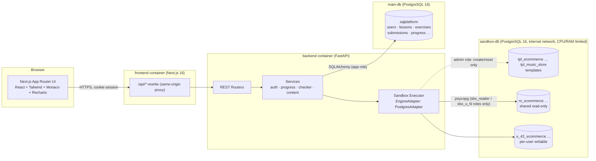

# 02 — System Architecture

> STEP 3

## 1. ภาพรวม



หลักการสำคัญ
1. **Main DB กับ Sandbox แยก cluster กัน** — SQL ของผู้ใช้ไม่มีทางไปถึง `sqlplatform` เพราะ connection ที่ใช้รัน SQL ผู้ใช้ชี้ไปที่ sandbox host เท่านั้น และ role ใน sandbox ไม่มีอยู่ใน main
2. **Same-origin**: Browser คุยกับ Next.js เท่านั้น; Next.js rewrite `/api/*` → FastAPI ทำให้ cookie เป็น first-party และไม่ต้องเปิด CORS กว้าง
3. **Content-as-code → DB**: บทเรียน/โจทย์อยู่ใน `backend/app/content/*.py` → `python -m app.seed` เขียนลง main DB และ **execute ตัวอย่าง/เฉลยจริงบน sandbox** เพื่อเก็บ example result และ expected result

## 2. Backend layering

```
backend/app
├── main.py              # FastAPI app, middleware (request id, logging, error handler)
├── config.py            # pydantic-settings (env vars เท่านั้น)
├── db.py                # SQLAlchemy engine/session (main DB)
├── models.py            # ORM models
├── schemas.py           # Pydantic request/response models (validation)
├── security.py          # password hashing (argon2), session tokens, RBAC deps
├── ratelimit.py         # token-bucket rate limiter
├── routers/             # HTTP layer เท่านั้น (บาง)
│   auth · me (dashboard, heartbeat, library) · learn (courses, lessons) · practice · playground (+ databases, saved queries)
├── services/            # business logic (ไม่รู้จัก HTTP)
│   ├── sandbox/         # base.py (EngineAdapter protocol, result types) + postgres.py (executor + provisioning)
│   ├── checker.py       # result-based answer checking (pure functions → unit-testable)
│   ├── validator.py     # libpg_query syntax validation
│   ├── sql_split.py     # statement splitting with source offsets
│   └── progress.py      # activity, streak, level, accuracy, achievements, dashboard
├── content/             # lessons + exercises (content-as-code)
├── sample_dbs/          # generator + generated *.sql ของ 5 sample databases
└── seed.py              # provision sandbox + seed content
```

## 3. Sandbox design (หัวใจด้านความปลอดภัย)

### 3.1 Databases ใน sandbox cluster
| DB | สร้างโดย | ใช้ทำอะไร | ใครเชื่อมต่อได้ |
|---|---|---|---|
| `tpl_<key>` | admin ตอน provision | ต้นแบบ (template) — ไม่มีใครรัน query | admin เท่านั้น (`datallowconn=false` หลังสร้าง) |
| `ro_<key>` | clone จาก template | Playground โหมด read-only + ตรวจโจทย์ SELECT | `sbx_reader` (SELECT only) |
| `u_<uid>_<key>` | สร้างเมื่อผู้ใช้เปิดโหมด writable ครั้งแรก | DDL/DML ส่วนตัว, โจทย์ DML | `sbx_u_<uid>` (owner) เท่านั้น |

### 3.2 การบังคับใช้ข้อจำกัด
| ชั้น | กลไก |
|---|---|
| Network | sandbox อยู่ใน Docker network `internal: true` → ไม่มี outbound internet |
| OS | ไม่มี untrusted PL / extensions; role ไม่ได้อยู่ใน `pg_read_server_files`, `pg_write_server_files`, `pg_execute_server_program` |
| Privileges | `REVOKE ALL ON DATABASE … FROM PUBLIC`; `GRANT CONNECT` เฉพาะ role ที่ควรเข้าได้; `sbx_reader`: `GRANT SELECT` + `default_transaction_read_only=on` |
| Resources | ROLE-level `statement_timeout`, `work_mem`, `temp_file_limit` (superuser-only GUC), `CONNECTION LIMIT`; container `cpus: 1.0`, `mem_limit: 1g` |
| Concurrency | สร้าง/รีเซ็ต DB และ role ภายใต้ PostgreSQL advisory lock (ปลอดภัยข้าม worker) · role ผู้ใช้ `CONNECTION LIMIT 5` + retry สั้น ๆ → 429 เมื่อเต็ม |
| Executor | connection ใหม่ต่อ request, watchdog `conn.cancel()` ที่ `timeout+1s` (กันกรณีผู้ใช้ `SET statement_timeout=0`), single-row streaming ตัดที่ `MAX_ROWS`, จำกัดความยาว SQL และจำนวน statement, connection ถูกปิดทุกครั้ง (ไม่มี state ค้าง) |
| Read-only mode | ทุก statement รันใน `BEGIN READ ONLY … ROLLBACK` |
| Answer checking (DML) | clone template เป็น DB ชั่วคราว `chk_<uid>_<rand>` → รันคำตอบ → รัน `check_sql` → DROP; expected คำนวณจากเฉลยด้วยวิธีเดียวกันตอน seed → ไม่กระทบ sandbox ของผู้ใช้ และ COMMIT/ROLLBACK ในคำตอบทำงานเหมือน server จริง |
| Credentials | password ของ `sbx_u_<uid>` = `HMAC-SHA256(SANDBOX_ROLE_SECRET, uid)` คำนวณสด ไม่ต้องเก็บ ไม่ส่งถึง frontend |

### 3.3 EngineAdapter (รองรับ MySQL/SQLite ในอนาคต)
```python
class EngineAdapter(Protocol):
    engine: str                                   # "postgresql"
    def execute(self, target: Target, sql: str) -> ExecutionResult          # read-only targets run in BEGIN READ ONLY
    def execute_on_fresh_copy(self, user_id, db_key, sql, check_sql) -> ExecutionResult
    def introspect(self, target: Target) -> list[TableInfo]
    def readonly_target(self, db_key) -> Target
    def ensure_user_db(self, user_id, db_key) -> Target
    def reset_user_db(self, user_id, db_key) -> None
```
Router/Checker ใช้ผ่าน interface นี้ (ปัจจุบันมี implementation เดียวคือ `PostgresSandbox`) — การเพิ่ม MySQL = เพิ่ม `MySQLAdapter` + sample DB scripts ของ dialect นั้น + คอลัมน์ `engine` ที่มีอยู่แล้วในตาราง `sample_databases`/`exercises`

## 4. Answer checking algorithm
1. Execute คำตอบผู้ใช้ (read-only หรือ check-tx) → `actual`
2. `expected` = ผลของ solution ที่คำนวณตอน seed (SELECT) หรือคำนวณสดใน tx (DML)
3. เทียบ
   - **Columns**: จำนวน + ชื่อ (case-insensitive) ตามลำดับ — ถ้าโจทย์ตั้ง `check_column_names=false` จะเทียบเฉพาะจำนวน
   - **Normalize ค่า**: `NULL` คงเป็น `None` (ไม่เท่ากับ 0/''), `Decimal/float/int` → ปัดตาม `float_tolerance` (default 0.01), date/time → ISO string, bool คงเดิม
   - **Rows**: ถ้า `order_matters` → เทียบตามลำดับ; ไม่เช่นนั้นเทียบแบบ **multiset** (`Counter`) — ทำให้แถวซ้ำมีผล (DISTINCT ผิด/ถูกจับได้)
4. คืน `CheckResult{correct, reason_code, message_th, details}` เช่น `ROW_COUNT_MISMATCH`, `COLUMN_MISMATCH`, `VALUE_MISMATCH` (+ แถวตัวอย่างที่หาย/เกิน), `ORDER_MISMATCH`

## 5. Frontend architecture
- **Next.js App Router** (`app/`), client components เฉพาะที่ interactive
- `lib/api.ts` — typed fetch wrapper (`credentials: 'include'`), error เป็น `ApiError`
- `lib/types.ts` — TypeScript types สะท้อน Pydantic schemas
- Components: `AppShell` (Sidebar + Topbar), `SqlEditor` (Monaco + completion + markers), `ResultTable`, `SchemaExplorer`, `ProgressBar`, `StatCard`, `EmptyState`, `ErrorState`, `Spinner`
- Theme: class-based dark mode (`next-themes`-free, localStorage + `prefers-color-scheme`)
- Monaco โหลดจาก npm package (`loader.config({ monaco })`) — ไม่พึ่ง CDN

## 6. Deployment (Docker Compose)
| Service | Image | Network | Notes |
|---|---|---|---|
| `main-db` | postgres:16 | `backend` | volume `main-data` |
| `sandbox-db` | postgres:16 | `sandbox` (internal) | `cpus: 1`, `mem_limit: 1g`, custom `postgresql.conf` |
| `backend` | python:3.13-slim | `backend`, `sandbox`, `web` | รัน `alembic upgrade head` + `python -m app.seed` ก่อน `uvicorn` |
| `frontend` | node:22 | `web` | `BACKEND_URL=http://backend:8000` |

## 7. Observability
- ทุก request มี `X-Request-ID`; log JSON line: `event=sql_exec user=… db=… mode=… ms=… rows=… status=ok|error|timeout`
- Exception handler กลาง: ซ่อน stack trace จากผู้ใช้, log ฝั่ง server
