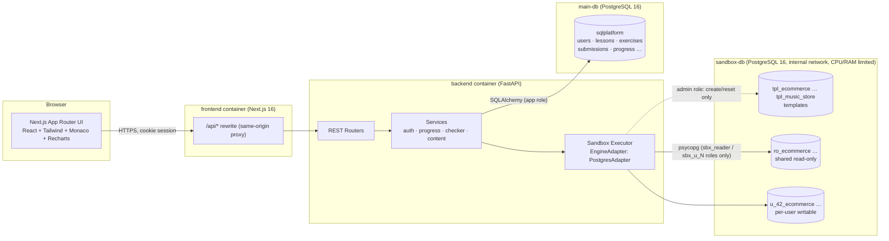
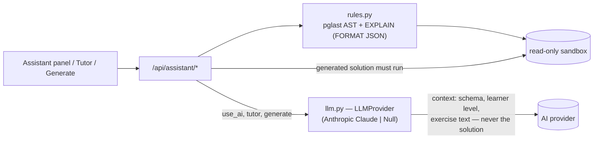

# 02 — System Architecture

> STEP 3

## 1. ภาพรวม



หลักการสำคัญ
1. **Main DB กับ Sandbox แยก cluster กัน** — SQL ของผู้ใช้ไม่มีทางไปถึง `sqlplatform` เพราะ connection ที่ใช้รัน SQL ผู้ใช้ชี้ไปที่ sandbox host เท่านั้น และ role ใน sandbox ไม่มีอยู่ใน main
2. **Same-origin**: Browser คุยกับ Next.js เท่านั้น; Next.js rewrite `/api/*` → FastAPI ทำให้ cookie เป็น first-party และไม่ต้องเปิด CORS กว้าง
3. **Content-as-code → DB**: บทเรียน/โจทย์อยู่ใน `backend/app/content/*.py` → `python -m app.seed` เขียนลง main DB และ **execute ตัวอย่าง/เฉลยจริงบน sandbox** เพื่อเก็บ example result และ expected result

## 2. Backend layering

```
backend/app
├── main.py              # FastAPI app, middleware (request id, logging, error handler)
├── config.py            # pydantic-settings (env vars เท่านั้น)
├── db.py                # SQLAlchemy engine/session (main DB)
├── models.py            # ORM models
├── schemas.py           # Pydantic request/response models (validation)
├── security.py          # password hashing (argon2), session tokens, RBAC deps
├── ratelimit.py         # token-bucket rate limiter
├── routers/             # HTTP layer เท่านั้น (บาง)
│   auth · me · learn · practice · projects · playground (+ databases, saved queries) · assistant · admin
│   Phase 3: dialects · optimize (plans) · designs · imports (csv) · challenges (+ leaderboard) · discussions
├── services/            # business logic (ไม่รู้จัก HTTP)
│   ├── sandbox/         # base.py (EngineAdapter protocol, result types) + postgres.py (executor + provisioning)
│   │                    # + sqlite_engine.py / sqlite_worker.py (Phase 3)
│   ├── checker.py       # result-based answer checking (pure functions → unit-testable)
│   ├── validator.py     # libpg_query syntax validation
│   ├── sql_split.py     # statement splitting with source offsets
│   ├── progress.py      # activity, streak, level, accuracy, achievements, projects, dashboard
│   ├── content.py       # run examples / compute expected results (seeder + admin)
│   ├── assistant/       # rules.py (pglast + EXPLAIN), llm.py (LLMProvider), service.py
│   └── plans.py · dialects.py · er_design.py · csv_import.py · challenges.py   # Phase 3
├── content/             # lessons + exercises (content-as-code)
├── sample_dbs/          # generator + generated *.sql ของ sample databases (+ blank.sql)
└── seed.py              # provision sandbox + seed content
```

## 3. Sandbox design (หัวใจด้านความปลอดภัย)

### 3.1 Databases ใน sandbox cluster
| DB | สร้างโดย | ใช้ทำอะไร | ใครเชื่อมต่อได้ |
|---|---|---|---|
| `tpl_<key>` | admin ตอน provision | ต้นแบบ (template) — ไม่มีใครรัน query | admin เท่านั้น (`datallowconn=false` หลังสร้าง) |
| `ro_<key>` | clone จาก template | Playground โหมด read-only + ตรวจโจทย์ SELECT | `sbx_reader` (SELECT only) |
| `u_<uid>_<key>` | สร้างเมื่อผู้ใช้เปิดโหมด writable ครั้งแรก | DDL/DML ส่วนตัว, โจทย์ DML | `sbx_u_<uid>` (owner) เท่านั้น |

### 3.2 การบังคับใช้ข้อจำกัด
| ชั้น | กลไก |
|---|---|
| Network | sandbox อยู่ใน Docker network `internal: true` → ไม่มี outbound internet |
| OS | ไม่มี untrusted PL / extensions; role ไม่ได้อยู่ใน `pg_read_server_files`, `pg_write_server_files`, `pg_execute_server_program` |
| Privileges | `REVOKE ALL ON DATABASE … FROM PUBLIC`; `GRANT CONNECT` เฉพาะ role ที่ควรเข้าได้; `sbx_reader`: `GRANT SELECT` + `default_transaction_read_only=on` |
| Resources | ROLE-level `statement_timeout`, `work_mem`, `temp_file_limit` (superuser-only GUC), `CONNECTION LIMIT`; container `cpus: 1.0`, `mem_limit: 1g` |
| Concurrency | สร้าง/รีเซ็ต DB และ role ภายใต้ PostgreSQL advisory lock (ปลอดภัยข้าม worker) · role ผู้ใช้ `CONNECTION LIMIT 5` + retry สั้น ๆ → 429 เมื่อเต็ม |
| Executor | connection ใหม่ต่อ request, watchdog `conn.cancel()` ที่ `timeout+1s` (กันกรณีผู้ใช้ `SET statement_timeout=0`), single-row streaming ตัดที่ `MAX_ROWS`, จำกัดความยาว SQL และจำนวน statement, connection ถูกปิดทุกครั้ง (ไม่มี state ค้าง) |
| Read-only mode | ทุก statement รันใน `BEGIN READ ONLY … ROLLBACK` |
| Answer checking (DML) | clone template เป็น DB ชั่วคราว `chk_<uid>_<rand>` → รันคำตอบ → รัน `check_sql` → DROP; expected คำนวณจากเฉลยด้วยวิธีเดียวกันตอน seed → ไม่กระทบ sandbox ของผู้ใช้ และ COMMIT/ROLLBACK ในคำตอบทำงานเหมือน server จริง |
| Credentials | password ของ `sbx_u_<uid>` = `HMAC-SHA256(SANDBOX_ROLE_SECRET, uid)` คำนวณสด ไม่ต้องเก็บ ไม่ส่งถึง frontend |

### 3.3 EngineAdapter และ engine ที่สอง: SQLite (Phase 3)
```python
class EngineAdapter(Protocol):
    engine: str                                   # "postgresql" | "sqlite"
    def execute(self, target: Target, sql: str) -> ExecutionResult
    def introspect(self, target: Target) -> list[TableInfo]
    def readonly_target(self, db_key) -> Target
    def ensure_user_db(self, user_id, db_key) -> Target
    def reset_user_db(self, user_id, db_key) -> None
```
`get_engine(name)` คืน `PostgresSandbox` หรือ `SqliteSandbox` — Playground, Explain, Designer (apply), CSV import และ Dialect comparison เลือก engine ผ่าน interface นี้
การตรวจคำตอบแบบฝึกหัด/challenge ยังใช้ PostgreSQL (`execute_on_fresh_copy`, expected คำนวณบน PostgreSQL)

**SQLite sandbox** (`services/sandbox/sqlite_engine.py` + `sqlite_worker.py`)
| ชั้น | กลไก |
|---|---|
| ข้อมูล | ตอน seed/rebuild ทุก sample DB ถูก export จาก `ro_<key>` ของ PostgreSQL เป็น `var/sqlite/ro_<key>.sqlite` (ไฟล์ mode 0444) → ข้อมูลเหมือนกันทุกแถว · Writable = สำเนาส่วนตัว `var/sqlite/users/u_<uid>_<key>.sqlite`, Reset = copy ใหม่ |
| Process | ทุก request รันใน process ใหม่ `python -I sqlite_worker.py` (stdlib อย่างเดียว) + `setsid` · rlimit: `RLIMIT_AS` 512 MB, `RLIMIT_CPU` = timeout + 2 s, `RLIMIT_FSIZE` = ขนาดสูงสุดของ DB ส่วนตัว, `RLIMIT_NOFILE` 32 · parent ฆ่า process group เมื่อเกินเวลา |
| SQLite authorizer | ปฏิเสธ `ATTACH`/`DETACH`, PRAGMA ที่ไม่ใช่ introspection, `load_extension`, ทุกการเขียนในโหมด read-only (เปิดไฟล์ด้วย `mode=ro` ด้วย) |
| Timeout / row cap | `progress_handler` ยกเลิก query เมื่อเกิน `QUERY_TIMEOUT_MS` · ตัดผลที่ `MAX_RESULT_ROWS` เหมือน PostgreSQL |
| Error mapping | `timeout`, `permission`, `limit` (เกินขนาดไฟล์ → ข้อความที่เข้าใจได้แทน "disk I/O error") |
| Deploy | volume `sqlite-data` → `/app/var` ของ backend (เขียนได้โดย uid 10001) |

MySQL: **ยังไม่มี implementation** — ไม่มี MySQL server ในสภาพแวดล้อมที่พัฒนา จึงมีเฉพาะ DDL generator และข้อมูลอ้างอิง dialect การเพิ่มทำได้ด้วย `MySQLAdapter` + การ export sample DB แบบเดียวกับ SQLite

### 3.4 Phase 3 features บน sandbox
| Feature | วิธีทำให้ปลอดภัย |
|---|---|
| Explain / Analyze | รับ 1 statement · `EXPLAIN (FORMAT JSON[, ANALYZE, BUFFERS])` ในสิทธิ์เดียวกับการรันปกติ · ANALYZE ของ DML/DDL บน writable target ห่อด้วย `BEGIN … ROLLBACK` · read-only target อยู่ใน `BEGIN READ ONLY` อยู่แล้ว |
| Index lab | รับเฉพาะ `CREATE INDEX` (ตรวจด้วย pglast, ≤ 3) · รันบนสำเนาชั่วคราวจาก template (`run_scripts_on_fresh_copy`) แล้ว DROP |
| Designer apply | DDL สร้างจาก design ที่ผ่าน validator (ชื่อ `[a-z_][a-z0-9_]*`, ชนิดจาก allow-list, default จาก allow-list) — ไม่ได้รับ SQL ดิบจากผู้ใช้ · รันใน DB `blank` ของผู้ใช้เท่านั้น |
| CSV import | ชื่อถูก sanitize, ชนิดจาก allow-list, ค่าเป็น data ของ `COPY` / bound parameter · PostgreSQL ใช้ connection ของ role ผู้ใช้เอง (ไม่ใช่ admin) |
| Challenges | deadline เก็บใน DB และตรวจทุก submit/hint; session ที่เลยเวลาถูกปิดเป็น `expired` · client timer มีไว้แสดงผลเท่านั้น |
| Community | spoiler gating ทำที่ server (ไม่ส่ง body) · Markdown render ด้วย react-markdown โดยไม่เปิด raw HTML · rate limit โพสต์/รายงาน · moderation ผ่าน admin |

## 4. Answer checking algorithm
1. Execute คำตอบผู้ใช้ (read-only หรือ check-tx) → `actual`
2. `expected` = ผลของ solution ที่คำนวณตอน seed (SELECT) หรือคำนวณสดใน tx (DML)
3. เทียบ
   - **Columns**: จำนวน + ชื่อ (case-insensitive) ตามลำดับ — ถ้าโจทย์ตั้ง `check_column_names=false` จะเทียบเฉพาะจำนวน
   - **Normalize ค่า**: `NULL` คงเป็น `None` (ไม่เท่ากับ 0/''), `Decimal/float/int` → ปัดตาม `float_tolerance` (default 0.01), date/time → ISO string, bool คงเดิม
   - **Rows**: ถ้า `order_matters` → เทียบตามลำดับ; ไม่เช่นนั้นเทียบแบบ **multiset** (`Counter`) — ทำให้แถวซ้ำมีผล (DISTINCT ผิด/ถูกจับได้)
4. คืน `CheckResult{correct, reason_code, message_th, details}` เช่น `ROW_COUNT_MISMATCH`, `COLUMN_MISMATCH`, `VALUE_MISMATCH` (+ แถวตัวอย่างที่หาย/เกิน), `ORDER_MISMATCH`

## 5. SQL Learning Assistant (Phase 2)


| หลักการ | การบังคับใช้ |
|---|---|
| AI เป็นตัวเสริม | ทุกโหมดวิเคราะห์ทำงานด้วย rules ก่อน; AI เพิ่มเฉพาะ `ai_md` · การตรวจคำตอบไม่ผ่าน AI |
| ไม่เฉลยเมื่อผู้เรียนขอคำใบ้ | ใน context ของแบบฝึกหัด prompt ไม่มีเฉลยเลย + คำสั่ง hint-only (มี integration test ยืนยันว่าเฉลยไม่หลุดเข้า prompt) |
| เปลี่ยนผู้ให้บริการได้ | `LLMProvider` protocol + `PROVIDERS` registry + env `ASSISTANT_PROVIDER` |
| Key ไม่ถึง frontend | อ่านจาก env ฝั่ง backend เท่านั้น; frontend เห็นแค่ `/assistant/status` |
| ควบคุมค่าใช้จ่าย | ต้อง login, rate limit ต่อนาที, โควตารายวันจาก `assistant_logs`, effort ต่ำสำหรับแชต |
| โจทย์ที่ AI สร้างเชื่อถือได้ | ต้องเป็น SELECT เดียว (pglast), รันผ่าน, 1–200 แถว — expected มาจากการรันจริง; ไม่ผ่านให้ AI แก้ 1 ครั้งพร้อมเหตุผล |
| Refusal | ใช้ server-side fallback (`fallbacks: "default"`) และแปลง `stop_reason: refusal` เป็นข้อความที่เข้าใจได้ |

## 6. Admin Panel & content governance (Phase 2)
- `APIRouter(dependencies=[Depends(require_role("admin"))])` — ทุก route ของ `/api/admin` ถูกบังคับ RBAC ที่ระดับ router
- เนื้อหาที่บันทึกผ่าน Admin ใช้ `services/content.py` ชุดเดียวกับ seeder: ตัวอย่างและเฉลยถูก **รันจริง** ก่อนบันทึก
- `is_custom` (สร้างใน Admin) / `admin_edited` (แก้ใน Admin) → seeder ข้ามแถวเหล่านี้ ไม่ทับและไม่ลบ; `revert` คืนบทให้ content-as-code
- `PostgresSandbox.provision_one(key, force=True)` rebuild DB เดียว แล้วคำนวณ expected ของโจทย์บน DB นั้นใหม่
- Audit: `event=admin_action admin=… action=… target=…`

## 7. Frontend architecture
- **Next.js App Router** (`app/`), client components เฉพาะที่ interactive
- `lib/api.ts` — typed fetch wrapper (`credentials: 'include'`), error เป็น `ApiError`
- `lib/types.ts` — TypeScript types สะท้อน Pydantic schemas
- Components: `AppShell` (Sidebar + Topbar), `SqlEditor` (Monaco + completion + markers), `ResultTable`, `SchemaExplorer`, `ProgressBar`, `StatCard`, `EmptyState`, `ErrorState`, `Spinner`
- Theme: class-based dark mode (`next-themes`-free, localStorage + `prefers-color-scheme`)
- Monaco โหลดจาก npm package (`loader.config({ monaco })`) — ไม่พึ่ง CDN

## 8. Deployment (Docker Compose)
| Service | Image | Network | Notes |
|---|---|---|---|
| `main-db` | postgres:16 | `backend` | volume `main-data` |
| `sandbox-db` | postgres:16 | `sandbox` (internal) | `cpus: 1`, `mem_limit: 1g`, custom `postgresql.conf` |
| `backend` | python:3.13-slim | `backend`, `sandbox`, `web` | รัน `alembic upgrade head` + `python -m app.seed` ก่อน `uvicorn` |
| `frontend` | node:22 | `web` | `BACKEND_URL=http://backend:8000` |

## 9. Observability
- ทุก request มี `X-Request-ID`; log JSON line: `event=sql_exec user=… db=… mode=… ms=… rows=… status=ok|error|timeout`
- Exception handler กลาง: ซ่อน stack trace จากผู้ใช้, log ฝั่ง server
