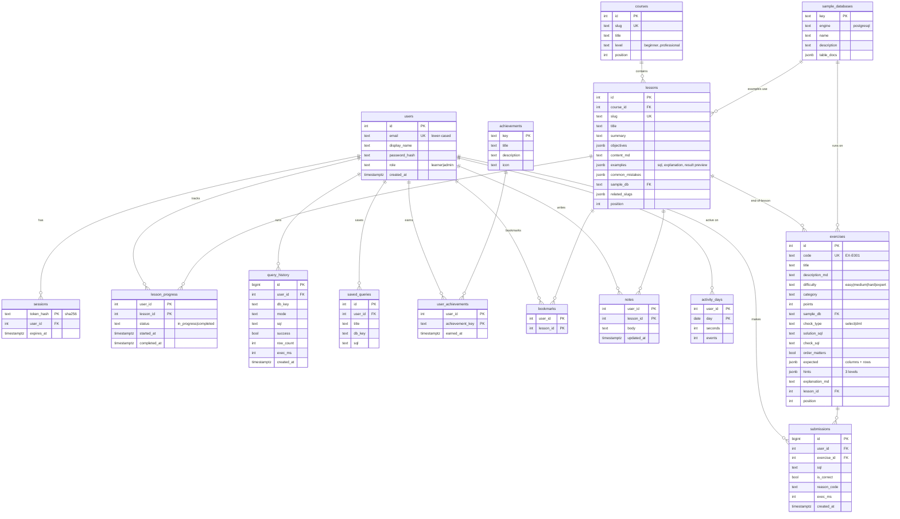
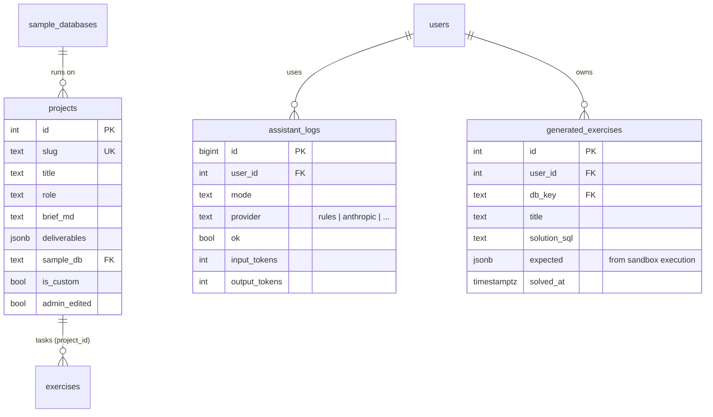
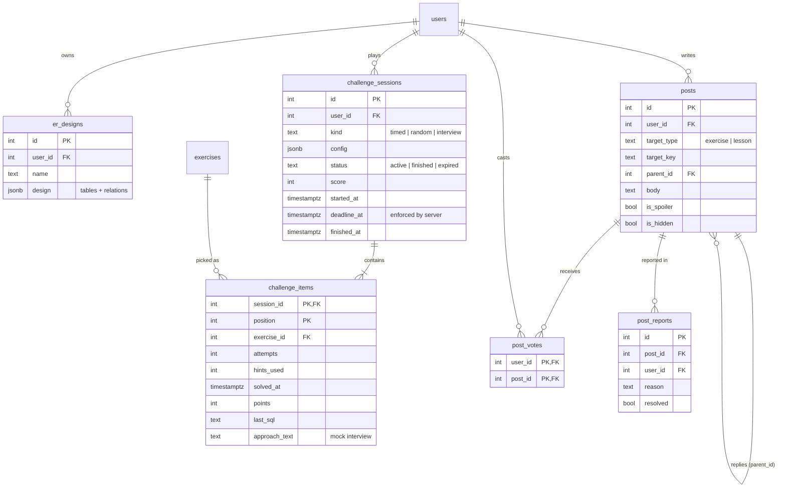

# 03 — Database Schema & ER Diagram

> STEP 4 — ฐานข้อมูลหลักของแพลตฟอร์ม (`sqlplatform` บน main-db)
> Schema จริงสร้างด้วย Alembic migration `backend/alembic/versions/0001_initial.py`
> ER Diagram ของ **sample databases** ทั้ง 5 ถูก generate จาก catalog จริงและแสดงในหน้า Databases ของเว็บ (ดู [`sample-databases.md`](sample-databases.md))

## 1. ER Diagram (main DB)

### Phase 2 additions (migration `0002_phase_2.py`)

- `lessons`, `exercises` เพิ่ม `is_custom`, `admin_edited` (content governance) และ `exercises.project_id`
- `assistant_logs` ไม่เก็บ prompt/คำตอบ — เก็บเฉพาะ metadata สำหรับสถิติและโควตา

### Phase 3 additions (migration `0003_phase3.py`)

- `users.show_on_leaderboard` (opt-out) · `exercises.is_interview` (ชุดโจทย์ Mock Interview ไม่ปนกับแบบฝึกหัด) · `query_history.engine`, `saved_queries.engine`
- `posts` อ้างเป้าหมายด้วย `(target_type, target_key)` + index แทน FK สองชุด เพราะบทเรียน/โจทย์อาจถูกแก้รหัสโดย admin และกระทู้ควรอยู่ต่อ
- Leaderboard คำนวณสดจาก `submissions` (คำตอบถูกครั้งแรกของแต่ละข้อ) และ `challenge_sessions` — ไม่มีตารางสรุปที่ต้อง sync
- ฐานข้อมูล SQLite ไม่อยู่ใน main DB: เป็นไฟล์ใน `var/sqlite/` · ฐานข้อมูล MySQL อยู่บน server `sandbox-mysql` แยก (`ro_<key>`, `u_<uid>_<key>`) — ไม่มีตารางใหม่ใน main DB สำหรับ MySQL (ดู architecture §3.3)

## 2. Design decisions
| เรื่อง | การตัดสินใจ | เหตุผล |
|---|---|---|
| Session | ตาราง `sessions` เก็บ SHA-256 ของ token | revoke ได้ทันที (logout / ban), token รั่วจาก DB dump ใช้ไม่ได้ |
| Expected result | เก็บใน `exercises.expected` (JSONB) คำนวณตอน seed | ไม่ต้องรันเฉลยทุกครั้งที่ submit, แสดงใน UI ได้ทันที; ถ้าแก้ sample DB → re-seed คำนวณใหม่อัตโนมัติ |
| Activity / streak | `activity_days(user_id, day)` upsert ต่อ event | คำนวณ streak ด้วย query เดียว, เก็บ learning time รายวัน |
| Learning time | heartbeat จาก frontend ทุก 60s ขณะแท็บ active (cap 60s/heartbeat) | ตัวเลขจริง ไม่ใช่ประมาณ |
| Level (ความสามารถ) | คำนวณจากคะแนนรวมของโจทย์ที่ทำถูก (distinct) | deterministic, อธิบายได้ |
| Engine | `sample_databases.engine` | พร้อมรองรับ MySQL/SQLite |
| Index | `submissions(user_id, created_at)`, `submissions(user_id, exercise_id)`, `query_history(user_id, created_at)` | หน้า Dashboard/History |

## 3. Sample databases (sandbox cluster)

| Key | Tables | กรณีพิเศษที่ตั้งใจใส่ |
|---|---|---|
| `ecommerce` | customers, categories (มี parent_id → recursive), products, orders, order_items, payments | ลูกค้าไม่เคยสั่งซื้อ, สินค้าไม่เคยขาย, หมวดไม่มีสินค้า, phone/city เป็น NULL, order ที่ไม่มี payment, ชื่อเมืองสะกดซ้ำ, ราคาซ้ำ |
| `hr` | departments, positions, employees (manager_id → self join), salaries (ประวัติ) | แผนกไม่มีพนักงาน, พนักงานไม่มีแผนก (NULL), CEO ไม่มี manager, commission NULL |
| `banking` | customers, accounts, transactions, loans | ลูกค้าไม่มีบัญชี, บัญชีปิด, transaction ยอดติดลบ (withdraw), loan ที่ยังไม่อนุมัติ (approved_at NULL) |
| `hospital` | patients, doctors, appointments, treatments | appointment ถูกยกเลิก (ไม่มี treatment), แพทย์ไม่มีนัด, ผู้ป่วยไม่มี phone |
| `music_store` | artists, albums, tracks, playlists, playlist_tracks, invoices, invoice_items | ศิลปินไม่มีอัลบั้ม, track ไม่เคยขาย, composer NULL, playlist ว่าง |
| `saas` *(advanced, Phase 2)* | plans, companies, users, subscriptions, invoices, events (JSONB, ~43k) | แพ็กเกจ Legacy ที่ปิดขาย, trial ที่ไม่ convert, บริษัทที่ churn, ผู้ใช้ไม่เคยกลับมา (last_seen NULL), event ที่ properties ว่าง, invoice ค้างชำระ |
| `blank` *(Phase 3)* | — (ว่าง) | พื้นที่สำหรับสร้างตารางจาก DB Designer และนำเข้า CSV ใน Writable sandbox ของแต่ละผู้ใช้ |

> `playlist_tracks` เพิ่มเป็น junction table ที่จำเป็นสำหรับความสัมพันธ์ many-to-many ระหว่าง playlists ↔ tracks

ข้อมูลถูก generate แบบ deterministic (`random.seed`) โดย `backend/app/sample_dbs/generate.py` → ไฟล์ `*.sql` ที่ commit ไว้ ทำให้ผลลัพธ์ที่คาดหวังของโจทย์คงที่ทุกการติดตั้ง
