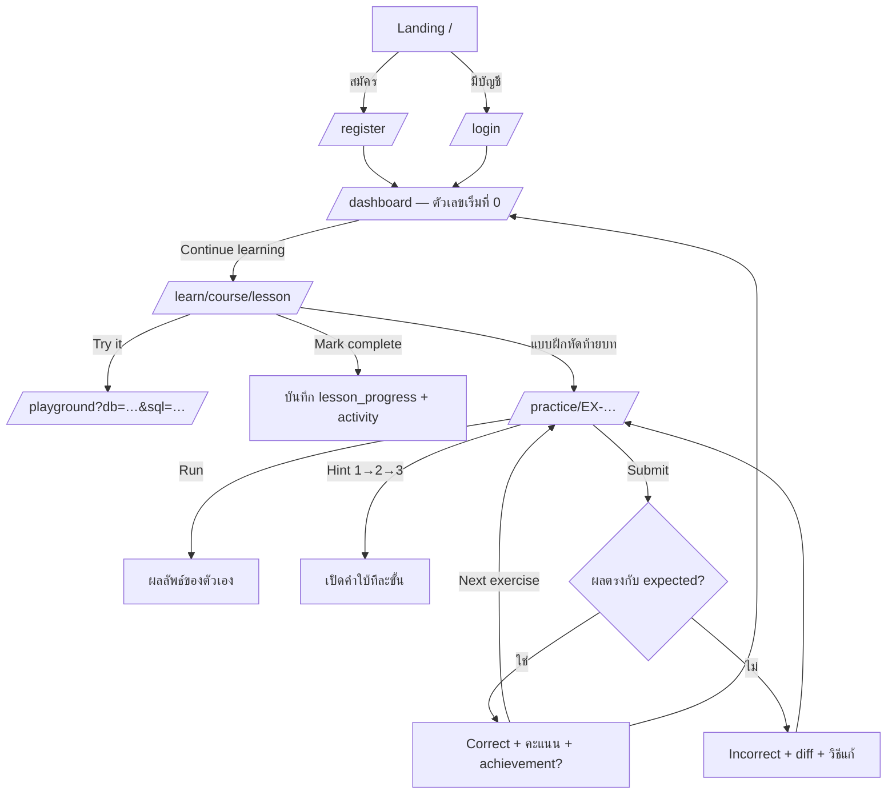
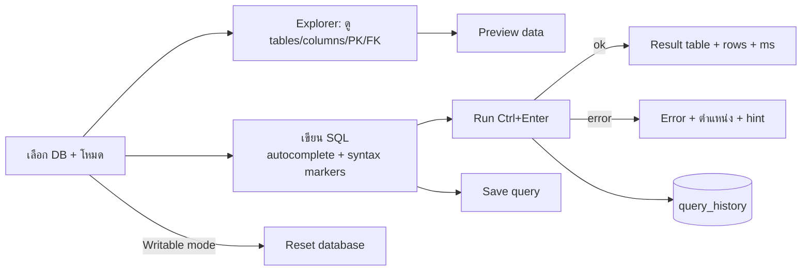

# 04 — User Flow, Sitemap & Main Screens

> STEP 5 (User Flow) + STEP 6 (Sitemap & หน้าจอหลัก)

## 1. User Flows

### 1.1 Onboarding → Learn → Practice (LEARN → EXPERIMENT → PRACTICE)


### 1.2 Playground (EXPERIMENT)


### 1.3 Guest
ผู้ที่ยังไม่ login: อ่านบทเรียน + ใช้ Playground (read-only) ได้ — เพื่อให้ลองก่อนสมัคร
แต่ Submit, Progress, History, Saved, Writable sandbox → ต้อง login (UI แสดง CTA "เข้าสู่ระบบเพื่อบันทึกความคืบหน้า")

## 2. Sitemap

```
/                         Landing (แนวคิด LEARN → EXPERIMENT → PRACTICE → ANALYZE → APPLY)
/login  /register         Authentication
/dashboard                ภาพรวมผู้เรียน (auth)
/learn                    รายการหลักสูตร 4 ระดับ + progress
/learn/[course]           Table of Contents ของหลักสูตร
/learn/[course]/[lesson]  บทเรียน
/playground               SQL Playground (3 panes)
/practice                 รายการโจทย์ + filter (difficulty / category / status)
/practice/[code]          ทำโจทย์
/databases                Sample databases ทั้ง 5
/databases/[key]          ER diagram + คำอธิบาย table/column + preview
/profile                  Achievements, bookmarks, notes, saved queries, history (auth)
/projects                 Phase 2 — แสดงสถานะ "Coming in Phase 2" (ไม่มีปุ่มหลอก)
/admin                    Phase 2 — เฉพาะ role admin
```

## 3. Main screens (wireframes)

### 3.1 App shell
```
┌──────────┬───────────────────────────────────────────────────────┐
│ ◆ SQLab  │  [search…]                    ☾/☀   🔥 3   (avatar ▾) │ ← Topbar
│──────────│───────────────────────────────────────────────────────│
│ Dashboard│                                                       │
│ Learn    │                    page content                       │
│ Playgrnd │                                                       │
│ Practice │                                                       │
│ Databases│                                                       │
│ Projects·│                                                       │
│ Profile  │                                                       │
└──────────┴───────────────────────────────────────────────────────┘
  Mobile: sidebar → drawer (hamburger)
```

### 3.2 Dashboard
```
[บทเรียนจบ 5/62] [โจทย์สำเร็จ 8/60] [Accuracy 72%] [Streak 🔥3] [Level: Intermediate]
┌ Course progress ─────────────┐ ┌ Activity 30 days (Recharts) ───────────┐
│ Beginner      ████████░ 80%  │ │  ▁▃▅▂▇ …  submissions vs correct        │
│ Intermediate  ██░░░░░░░ 20%  │ └─────────────────────────────────────────┘
└──────────────────────────────┘
┌ Continue learning ┐ ┌ Recent exercises ┐ ┌ Achievements ┐ ┌ Skill progress ┐
```

### 3.3 Playground (3 panes — Editor ได้พื้นที่มากที่สุด)
```
┌ Explorer ──────┬ Editor ───────────────────────────────────────────────┐
│ DB [ecommerce▾]│ [▶ Run] [Format] [Clear] [Save]  mode:(RO|Writable) ⟲│
│ ▾ customers    │  1  SELECT name, city                                  │
│   🔑 id int    │  2  FROM customers                                     │
│   name text    │  3  WHERE city = 'Bangkok';                            │
│ ▸ orders       │────────────────────────────────────────────────────────│
│ ▸ products     │ Results ✓ 12 rows · 4 ms        [History] [Saved]      │
│                │ ┌ name ─────────┬ city ───┐                            │
│ [Preview]      │ │ …             │ …       │                            │
└────────────────┴────────────────────────────────────────────────────────┘
  Tablet/Mobile: Explorer ซ่อนเป็น drawer, Results อยู่ใต้ Editor
```

### 3.4 Practice exercise
```
┌ EX-M004 · Medium · GROUP BY · 20 pts ──────┬ Editor ─────────────────────┐
│ โจทย์ (markdown)                            │                             │
│ Database: ecommerce  [Schema ▾]             │ [▶ Run] [✓ Submit] [Format] │
│ Expected result (ตัวอย่าง 5 แถว)            │─────────────────────────────│
│ [Hint 1] [Hint 2] [Hint 3] [Show solution]  │ Result / Check feedback     │
│ ← Prev                         Next →       │ ✗ จำนวนแถวไม่ตรง: 12 vs 10  │
└─────────────────────────────────────────────┴─────────────────────────────┘
```

### 3.5 Design system
- Font: system UI stack + ฟอนต์ไทยของระบบ (Noto Sans Thai / Sarabun / Leelawadee UI), monospace สำหรับโค้ด — ไม่โหลดฟอนต์จาก CDN
- สี: neutral (zinc) + accent **teal** (brand), success green, danger rose, warning amber
- Radius 8px, border 1px subtle, เงาน้อย — "developer tool" look
- States: `Spinner`/skeleton (loading), `EmptyState` (ไม่มีข้อมูล + CTA), `ErrorState` (ข้อความ + retry)
