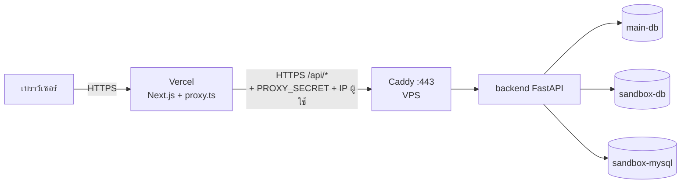

# Production deployment — Frontend บน Vercel + Backend บน VPS


- เบราว์เซอร์คุยกับ Vercel เท่านั้น — `/api/*` ถูก `frontend/proxy.ts` ส่งต่อไป backend ฝั่ง server ทำให้ cookie เป็น first-party บนโดเมนของ Vercel
- ทุก request ที่ส่งต่อมี `PROXY_SECRET` (เก็บเป็น env ฝั่ง server ของ Vercel) และ IP จริงของผู้เรียน — backend **ปฏิเสธ `/api` ทุก request ที่ไม่มี secret (403)** ยกเว้น `/api/health` และใช้ IP ที่ส่งมาสำหรับ rate limit (ไม่อย่างนั้นผู้เรียนทุกคนจะแชร์ IP ของ Vercel)
- ยังไม่มีโดเมน: ใช้ `<ip-แบบขีด>.sslip.io` (DNS ฟรีที่ชี้กลับไปยัง IP นั้น) และ Caddy ขอใบรับรอง Let's Encrypt ให้อัตโนมัติ → ช่วง Vercel → VPS เข้ารหัสด้วย HTTPS
- ฐานข้อมูลทั้งหมดอยู่ใน Docker network ภายใน ไม่เปิด port ออกนอกเครื่อง · firewall เปิดแค่ 22/80/443

## 1. VPS
ต้องการ Ubuntu 22.04/24.04, RAM ≥ 4 GB (แนะนำ), disk ≥ 20 GB, IPv4 สาธารณะ
```bash
curl -fsSL https://raw.githubusercontent.com/noppawit1480-byte/1480SQLTest/main/deploy/install.sh -o install.sh
less install.sh
sudo ADMIN_EMAIL=you@example.com ADMIN_PASSWORD='รหัสผ่านยาว ๆ' -E bash install.sh
```
สคริปต์: ติดตั้ง Docker → clone repo ไป `/opt/sqlab` → สร้าง `/opt/sqlab/.env` พร้อมรหัสผ่าน/secret แบบสุ่ม (mode 600; **secret ไม่ออกจากเครื่อง**) → ตั้ง firewall → `docker compose -f docker-compose.yml -f deploy/docker-compose.vps.yml up -d --build` → รอ `https://<ip>.sslip.io/api/health` → แสดงค่า `BACKEND_URL`

## 2. Vercel
โปรเจกต์ Vercel ผูกกับ repo นี้, **Root Directory = `frontend`**, framework Next.js (ค่าเริ่มต้น) แล้วตั้ง Environment Variables (Production):

| Key | ค่า | ชนิด |
|---|---|---|
| `BACKEND_URL` | `https://<ip-แบบขีด>.sslip.io` (จากผลของ install.sh) | Plain |
| `PROXY_SECRET` | ค่า `TRUSTED_PROXY_SECRET` ใน `/opt/sqlab/.env` (`sudo grep TRUSTED_PROXY_SECRET /opt/sqlab/.env`) | **Sensitive** |

แล้ว Redeploy — ทุกครั้งที่ push เข้า `main` Vercel จะ deploy frontend ใหม่อัตโนมัติ

## 3. ตรวจหลัง deploy
```bash
curl -s https://<ip-แบบขีด>.sslip.io/api/health          # {"status":"ok"}
curl -s -o /dev/null -w '%{http_code}\n' https://<ip-แบบขีด>.sslip.io/api/courses   # 403 (เข้าตรงไม่ได้ — ถูกต้อง)
```
เปิดเว็บที่ `https://<project>.vercel.app` → สมัครสมาชิก → รัน SQL ใน Playground (ลองทั้ง 3 engine)

## 4. อัปเดตเวอร์ชัน backend
```bash
sudo bash /opt/sqlab/deploy/install.sh     # pull โค้ดล่าสุด + rebuild; .env เดิมถูกเก็บไว้
```

## 5. สำรองข้อมูล
```bash
sudo crontab -e     # เพิ่มบรรทัด:  15 3 * * * /opt/sqlab/deploy/backup.sh
```
สำรองเฉพาะ main DB (ผู้ใช้ ความคืบหน้า เนื้อหาที่แอดมินแก้) เก็บ 14 วันใน `/opt/sqlab/backups` — **ควรคัดลอกออกนอกเครื่องเป็นระยะ** · ฐานข้อมูล sandbox สร้างใหม่ได้จาก seed

## ภายหลัง: ใช้โดเมนของตัวเอง
ชี้ A record ของโดเมน (เช่น `api.example.com`) มาที่ IP ของ VPS → แก้ `SITE_ADDRESS` ใน `/opt/sqlab/.env` → `docker compose -f docker-compose.yml -f deploy/docker-compose.vps.yml up -d` → แก้ `BACKEND_URL` บน Vercel แล้ว Redeploy

## ข้อจำกัดที่ทราบ
- sslip.io เป็นบริการ DNS ภายนอก: ถ้าบริการนั้นล่ม Vercel จะหา backend ไม่เจอ — แนะนำย้ายไปโดเมนของตัวเองเมื่อพร้อม
- Rate limiter อยู่ใน memory ของ backend (1 instance) — ถ้าขยายหลายเครื่องต้องย้ายไป Redis
- การทดสอบ topology นี้ทำบนเครื่องพัฒนาด้วย HTTP ภายใน (ไม่มี IP สาธารณะสำหรับออกใบรับรอง): E2E 24/24 ผ่านทาง proxy + Caddy + secret — การออกใบรับรองจริงเกิดครั้งแรกบน VPS
