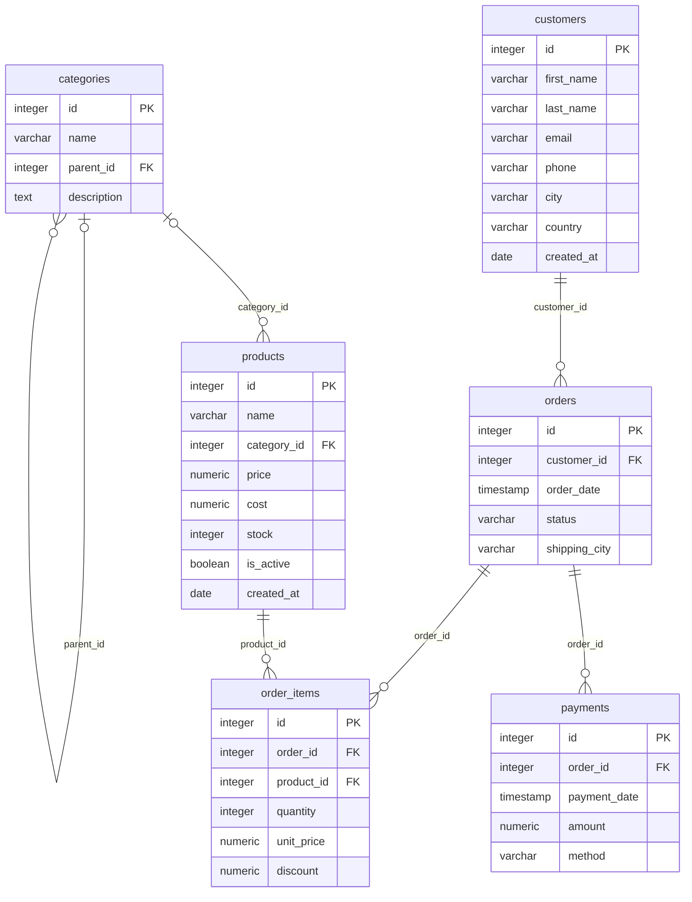
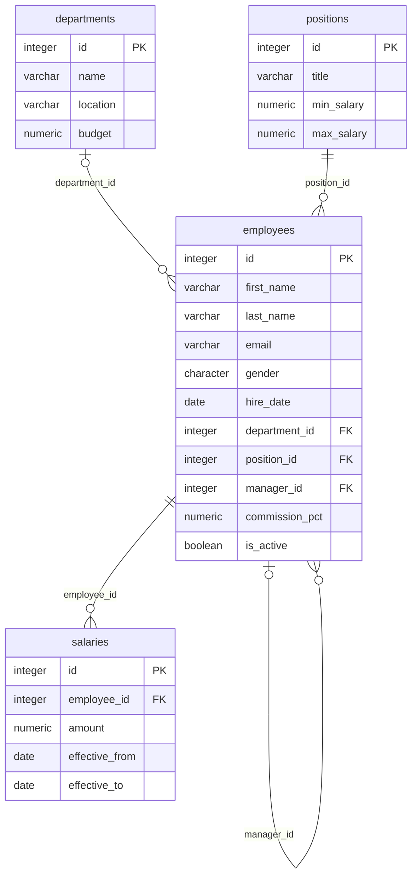
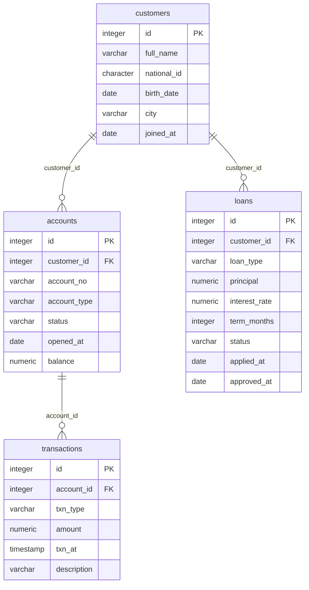
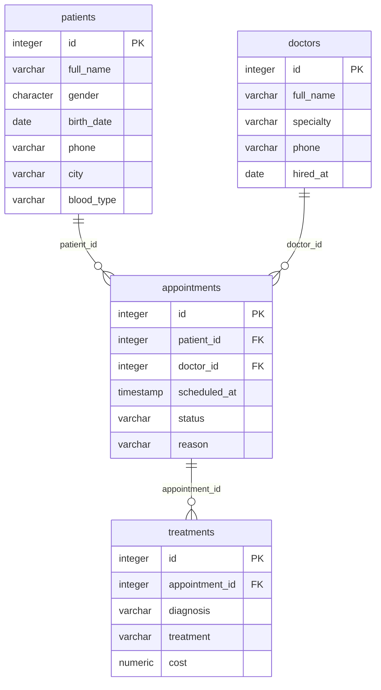
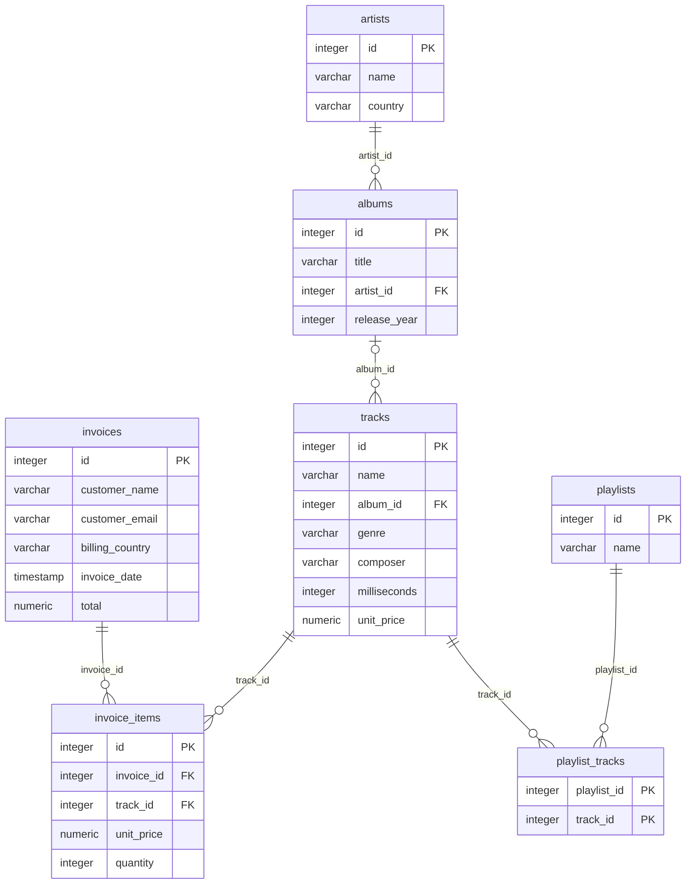
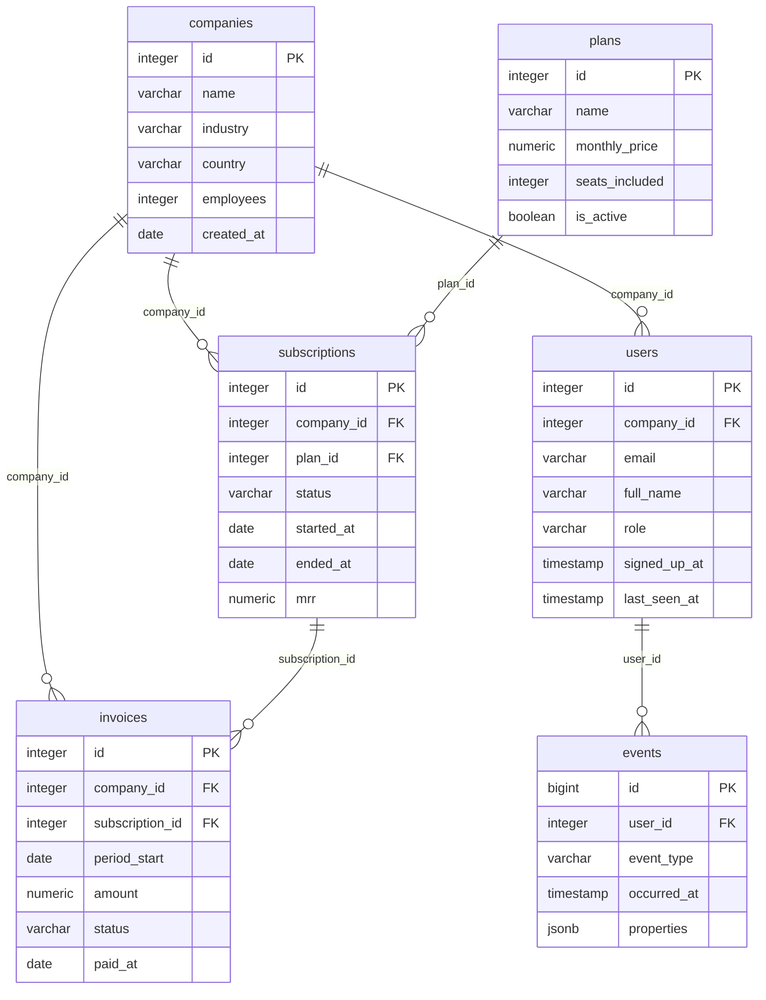

# Sample Databases — ER Diagrams & Data Dictionary

> GENERATED จาก catalog จริงของ sandbox (`GET /api/databases/{key}`) — หน้าเว็บ /databases แสดงข้อมูลเดียวกันแบบ interactive
> ทุกฐานข้อมูลมีสำเนา SQLite และ MySQL ที่ export จากข้อมูลชุดเดียวกัน (Phase 3) — ใช้ได้ทั้ง engine PostgreSQL, SQLite และ MySQL

## E-Commerce (`ecommerce`)

ร้านค้าออนไลน์: ลูกค้า สินค้า หมวดหมู่ (มีหมวดย่อย) คำสั่งซื้อ รายการสินค้า และการชำระเงิน ปี 2024–2025

### `categories` — 15 แถว

หมวดหมู่สินค้า (มีหมวดย่อยผ่าน parent_id — ใช้ฝึก Self Join / Recursive CTE)

| Column | Type | Null | Key | คำอธิบาย |
|---|---|---|---|---|
| `id` | integer | NO | PK |  |
| `name` | character varying(80) | NO |  |  |
| `parent_id` | integer | YES | FK → categories.id | หมวดแม่ (NULL = หมวดระดับบนสุด) |
| `description` | text | YES |  |  |

### `customers` — 150 แถว

ลูกค้า — บางคนยังไม่เคยสั่งซื้อ, บางคนไม่มี phone/city

| Column | Type | Null | Key | คำอธิบาย |
|---|---|---|---|---|
| `id` | integer | NO | PK |  |
| `first_name` | character varying(50) | NO |  |  |
| `last_name` | character varying(50) | NO |  |  |
| `email` | character varying(120) | NO |  |  |
| `phone` | character varying(20) | YES |  |  |
| `city` | character varying(60) | YES |  | เมือง (อาจเป็น NULL และสะกดไม่สม่ำเสมอ เช่น bangkok) |
| `country` | character varying(60) | NO |  |  |
| `created_at` | date | NO |  |  |

### `order_items` — 1666 แถว

รายการสินค้าในแต่ละคำสั่งซื้อ

| Column | Type | Null | Key | คำอธิบาย |
|---|---|---|---|---|
| `id` | integer | NO | PK |  |
| `order_id` | integer | NO | FK → orders.id |  |
| `product_id` | integer | NO | FK → products.id |  |
| `quantity` | integer | NO |  |  |
| `unit_price` | numeric(10,2) | NO |  | ราคาต่อชิ้น ณ วันที่สั่ง (อาจต่างจาก products.price ปัจจุบัน) |
| `discount` | numeric(10,2) | YES |  | ส่วนลดรวมของรายการ (NULL = ไม่มีส่วนลด) |

### `orders` — 900 แถว

คำสั่งซื้อ (ปี 2024-2025)

| Column | Type | Null | Key | คำอธิบาย |
|---|---|---|---|---|
| `id` | integer | NO | PK |  |
| `customer_id` | integer | NO | FK → customers.id |  |
| `order_date` | timestamp without time zone | NO |  |  |
| `status` | character varying(20) | NO |  | pending | paid | shipped | delivered | cancelled |
| `shipping_city` | character varying(60) | YES |  |  |

### `payments` — 946 แถว

การชำระเงิน — order ที่ pending/cancelled ไม่มี payment; บาง order ผ่อน 2 งวด

| Column | Type | Null | Key | คำอธิบาย |
|---|---|---|---|---|
| `id` | integer | NO | PK |  |
| `order_id` | integer | NO | FK → orders.id |  |
| `payment_date` | timestamp without time zone | NO |  |  |
| `amount` | numeric(12,2) | NO |  |  |
| `method` | character varying(20) | NO |  |  |

### `products` — 47 แถว

สินค้า — บางรายการไม่เคยขาย, บางรายการไม่มีหมวด

| Column | Type | Null | Key | คำอธิบาย |
|---|---|---|---|---|
| `id` | integer | NO | PK |  |
| `name` | character varying(120) | NO |  |  |
| `category_id` | integer | YES | FK → categories.id |  |
| `price` | numeric(10,2) | NO |  |  |
| `cost` | numeric(10,2) | NO |  | ต้นทุนต่อชิ้น (ใช้คำนวณกำไร) |
| `stock` | integer | NO |  |  |
| `is_active` | boolean | NO |  |  |
| `created_at` | date | NO |  |  |

## HR Management (`hr`)

ระบบบุคคล: แผนก ตำแหน่ง พนักงาน (มีสายบังคับบัญชา) และประวัติเงินเดือน

### `departments` — 8 แถว

แผนก — แผนก Research ยังไม่มีพนักงาน

| Column | Type | Null | Key | คำอธิบาย |
|---|---|---|---|---|
| `id` | integer | NO | PK |  |
| `name` | character varying(60) | NO |  |  |
| `location` | character varying(60) | YES |  |  |
| `budget` | numeric(14,2) | YES |  |  |

### `employees` — 66 แถว

พนักงาน — manager_id อ้างถึง employees.id (Self Join / Recursive CTE)

| Column | Type | Null | Key | คำอธิบาย |
|---|---|---|---|---|
| `id` | integer | NO | PK |  |
| `first_name` | character varying(50) | NO |  |  |
| `last_name` | character varying(50) | NO |  |  |
| `email` | character varying(120) | NO |  |  |
| `gender` | character(1) | YES |  |  |
| `hire_date` | date | NO |  |  |
| `department_id` | integer | YES | FK → departments.id | แผนก (NULL = ยังไม่ได้สังกัดแผนก) |
| `position_id` | integer | NO | FK → positions.id |  |
| `manager_id` | integer | YES | FK → employees.id | หัวหน้าโดยตรง (NULL = CEO) |
| `commission_pct` | numeric(4,2) | YES |  | ค่าคอมมิชชัน (เฉพาะฝ่ายขาย, อื่น ๆ เป็น NULL) |
| `is_active` | boolean | NO |  |  |

### `positions` — 12 แถว

ตำแหน่งงานและช่วงเงินเดือน

| Column | Type | Null | Key | คำอธิบาย |
|---|---|---|---|---|
| `id` | integer | NO | PK |  |
| `title` | character varying(80) | NO |  |  |
| `min_salary` | numeric(10,2) | NO |  |  |
| `max_salary` | numeric(10,2) | NO |  |  |

### `salaries` — 131 แถว

ประวัติเงินเดือน — effective_to IS NULL คือเงินเดือนปัจจุบัน

| Column | Type | Null | Key | คำอธิบาย |
|---|---|---|---|---|
| `id` | integer | NO | PK |  |
| `employee_id` | integer | NO | FK → employees.id |  |
| `amount` | numeric(10,2) | NO |  |  |
| `effective_from` | date | NO |  |  |
| `effective_to` | date | YES |  |  |

## Banking (`banking`)

ธนาคาร: ลูกค้า บัญชี ธุรกรรม (ยอดบวก/ลบ) และสินเชื่อ

### `accounts` — 132 แถว

บัญชี — balance = ผลรวม amount ของ transactions ในบัญชีนั้น

| Column | Type | Null | Key | คำอธิบาย |
|---|---|---|---|---|
| `id` | integer | NO | PK |  |
| `customer_id` | integer | NO | FK → customers.id |  |
| `account_no` | character varying(12) | NO |  |  |
| `account_type` | character varying(20) | NO |  |  |
| `status` | character varying(10) | NO |  |  |
| `opened_at` | date | NO |  |  |
| `balance` | numeric(14,2) | NO |  |  |

### `customers` — 100 แถว

ลูกค้าธนาคาร — บางคนยังไม่มีบัญชี

| Column | Type | Null | Key | คำอธิบาย |
|---|---|---|---|---|
| `id` | integer | NO | PK |  |
| `full_name` | character varying(100) | NO |  |  |
| `national_id` | character(13) | NO |  |  |
| `birth_date` | date | NO |  |  |
| `city` | character varying(60) | YES |  |  |
| `joined_at` | date | NO |  |  |

### `loans` — 32 แถว

สินเชื่อ — approved_at เป็น NULL ถ้ายังไม่อนุมัติหรือถูกปฏิเสธ

| Column | Type | Null | Key | คำอธิบาย |
|---|---|---|---|---|
| `id` | integer | NO | PK |  |
| `customer_id` | integer | NO | FK → customers.id |  |
| `loan_type` | character varying(20) | NO |  |  |
| `principal` | numeric(14,2) | NO |  |  |
| `interest_rate` | numeric(5,2) | NO |  |  |
| `term_months` | integer | NO |  |  |
| `status` | character varying(10) | NO |  |  |
| `applied_at` | date | NO |  |  |
| `approved_at` | date | YES |  |  |

### `transactions` — 2066 แถว

ธุรกรรม — amount เป็นบวก = เงินเข้า, ติดลบ = เงินออก

| Column | Type | Null | Key | คำอธิบาย |
|---|---|---|---|---|
| `id` | integer | NO | PK |  |
| `account_id` | integer | NO | FK → accounts.id |  |
| `txn_type` | character varying(20) | NO |  |  |
| `amount` | numeric(14,2) | NO |  | บวก: deposit/transfer_in/interest, ลบ: withdrawal/transfer_out/fee |
| `txn_at` | timestamp without time zone | NO |  |  |
| `description` | character varying(200) | YES |  |  |

## Hospital (`hospital`)

โรงพยาบาล: ผู้ป่วย แพทย์ นัดหมาย และการรักษา

### `appointments` — 700 แถว

นัดหมาย — cancelled/no_show/scheduled จะไม่มี treatment

| Column | Type | Null | Key | คำอธิบาย |
|---|---|---|---|---|
| `id` | integer | NO | PK |  |
| `patient_id` | integer | NO | FK → patients.id |  |
| `doctor_id` | integer | NO | FK → doctors.id |  |
| `scheduled_at` | timestamp without time zone | NO |  |  |
| `status` | character varying(12) | NO |  |  |
| `reason` | character varying(200) | YES |  |  |

### `doctors` — 20 แถว

แพทย์ — บางคนยังไม่มีนัด

| Column | Type | Null | Key | คำอธิบาย |
|---|---|---|---|---|
| `id` | integer | NO | PK |  |
| `full_name` | character varying(100) | NO |  |  |
| `specialty` | character varying(60) | NO |  |  |
| `phone` | character varying(20) | YES |  |  |
| `hired_at` | date | NO |  |  |

### `patients` — 160 แถว

ผู้ป่วย — phone และ blood_type อาจเป็น NULL

| Column | Type | Null | Key | คำอธิบาย |
|---|---|---|---|---|
| `id` | integer | NO | PK |  |
| `full_name` | character varying(100) | NO |  |  |
| `gender` | character(1) | NO |  |  |
| `birth_date` | date | NO |  |  |
| `phone` | character varying(20) | YES |  |  |
| `city` | character varying(60) | YES |  |  |
| `blood_type` | character varying(3) | YES |  |  |

### `treatments` — 633 แถว

การรักษา — 1 นัดอาจมีหลายการรักษา

| Column | Type | Null | Key | คำอธิบาย |
|---|---|---|---|---|
| `id` | integer | NO | PK |  |
| `appointment_id` | integer | NO | FK → appointments.id |  |
| `diagnosis` | character varying(120) | NO |  |  |
| `treatment` | character varying(200) | NO |  |  |
| `cost` | numeric(10,2) | NO |  |  |

## Music Store (`music_store`)

ร้านขายเพลงดิจิทัล: ศิลปิน อัลบั้ม เพลง เพลย์ลิสต์ ใบแจ้งหนี้ และรายการขาย

### `albums` — 42 แถว

อัลบั้ม

| Column | Type | Null | Key | คำอธิบาย |
|---|---|---|---|---|
| `id` | integer | NO | PK |  |
| `title` | character varying(160) | NO |  |  |
| `artist_id` | integer | NO | FK → artists.id |  |
| `release_year` | integer | YES |  |  |

### `artists` — 30 แถว

ศิลปิน — บางรายยังไม่มีอัลบั้ม

| Column | Type | Null | Key | คำอธิบาย |
|---|---|---|---|---|
| `id` | integer | NO | PK |  |
| `name` | character varying(120) | NO |  |  |
| `country` | character varying(60) | YES |  |  |

### `invoice_items` — 1297 แถว

รายการเพลงในใบแจ้งหนี้

| Column | Type | Null | Key | คำอธิบาย |
|---|---|---|---|---|
| `id` | integer | NO | PK |  |
| `invoice_id` | integer | NO | FK → invoices.id |  |
| `track_id` | integer | NO | FK → tracks.id |  |
| `unit_price` | numeric(6,2) | NO |  |  |
| `quantity` | integer | NO |  |  |

### `invoices` — 500 แถว

ใบแจ้งหนี้ — total = SUM(unit_price * quantity) ของ invoice_items

| Column | Type | Null | Key | คำอธิบาย |
|---|---|---|---|---|
| `id` | integer | NO | PK |  |
| `customer_name` | character varying(100) | NO |  |  |
| `customer_email` | character varying(120) | NO |  |  |
| `billing_country` | character varying(60) | NO |  |  |
| `invoice_date` | timestamp without time zone | NO |  |  |
| `total` | numeric(10,2) | NO |  |  |

### `playlist_tracks` — 161 แถว

ตารางเชื่อม many-to-many ระหว่าง playlists และ tracks

| Column | Type | Null | Key | คำอธิบาย |
|---|---|---|---|---|
| `playlist_id` | integer | NO | PK |  |
| `track_id` | integer | NO | PK |  |

### `playlists` — 8 แถว

เพลย์ลิสต์ — บางรายการยังว่าง

| Column | Type | Null | Key | คำอธิบาย |
|---|---|---|---|---|
| `id` | integer | NO | PK |  |
| `name` | character varying(120) | NO |  |  |

### `tracks` — 387 แถว

เพลง — composer อาจเป็น NULL, single บางเพลงไม่มี album (album_id NULL)

| Column | Type | Null | Key | คำอธิบาย |
|---|---|---|---|---|
| `id` | integer | NO | PK |  |
| `name` | character varying(200) | NO |  |  |
| `album_id` | integer | YES | FK → albums.id |  |
| `genre` | character varying(40) | NO |  |  |
| `composer` | character varying(200) | YES |  |  |
| `milliseconds` | integer | NO |  | ความยาวเพลง (มิลลิวินาที) |
| `unit_price` | numeric(6,2) | NO |  |  |

## Blank (ฐานข้อมูลว่าง) (`blank`)

ฐานข้อมูลว่างสำหรับออกแบบตารางเอง (ER Diagram Builder), นำเข้า CSV และฝึก CREATE TABLE ตั้งแต่ศูนย์ — ใช้ในโหมด Writable sandbox

_ฐานข้อมูลว่าง — ใช้เป็นพื้นที่สร้างตารางเองใน Writable sandbox (DB Designer / CSV import)_

## SaaS Analytics (Advanced) (`saas`)

ธุรกิจซอฟต์แวร์แบบสมาชิก: แพ็กเกจ บริษัทลูกค้า ผู้ใช้ ประวัติ subscription (MRR) ใบแจ้งหนี้ และ event stream แบบ JSONB ~43,000 แถว — สำหรับ retention, churn, cohort และ JSON

### `companies` — 120 แถว

บริษัทลูกค้า (tenant) — บางรายยังอยู่ช่วง trial หรือยกเลิกแล้ว

| Column | Type | Null | Key | คำอธิบาย |
|---|---|---|---|---|
| `id` | integer | NO | PK |  |
| `name` | character varying(120) | NO |  |  |
| `industry` | character varying(40) | YES |  | อุตสาหกรรม (อาจเป็น NULL) |
| `country` | character varying(40) | NO |  |  |
| `employees` | integer | YES |  |  |
| `created_at` | date | NO |  |  |

### `events` — 43210 แถว

event stream การใช้งานผลิตภัณฑ์ — properties เป็น JSONB (คีย์ไม่เหมือนกันทุก event)

| Column | Type | Null | Key | คำอธิบาย |
|---|---|---|---|---|
| `id` | bigint | NO | PK |  |
| `user_id` | integer | NO | FK → users.id |  |
| `event_type` | character varying(30) | NO |  |  |
| `occurred_at` | timestamp without time zone | NO |  |  |
| `properties` | jsonb | NO |  | เช่น {"device": "web", "duration_ms": 1200, "report_type": "sales"} |

### `invoices` — 1436 แถว

ใบแจ้งหนี้รายเดือน — status overdue/open = ยังไม่ได้รับเงิน

| Column | Type | Null | Key | คำอธิบาย |
|---|---|---|---|---|
| `id` | integer | NO | PK |  |
| `company_id` | integer | NO | FK → companies.id |  |
| `subscription_id` | integer | NO | FK → subscriptions.id |  |
| `period_start` | date | NO |  |  |
| `amount` | numeric(10,2) | NO |  |  |
| `status` | character varying(10) | NO |  |  |
| `paid_at` | date | YES |  |  |

### `plans` — 5 แถว

แพ็กเกจราคา (Legacy ปิดขายแล้วแต่ยังมีลูกค้าเดิมใช้)

| Column | Type | Null | Key | คำอธิบาย |
|---|---|---|---|---|
| `id` | integer | NO | PK |  |
| `name` | character varying(40) | NO |  |  |
| `monthly_price` | numeric(10,2) | NO |  |  |
| `seats_included` | integer | NO |  |  |
| `is_active` | boolean | NO |  |  |

### `subscriptions` — 347 แถว

ประวัติการสมัคร — 1 บริษัทมีหลายแถวเมื่ออัปเกรด/ดาวน์เกรด; ended_at IS NULL = ยังใช้งานอยู่; status trial + ended_at = ช่วงทดลองที่จบแล้ว

| Column | Type | Null | Key | คำอธิบาย |
|---|---|---|---|---|
| `id` | integer | NO | PK |  |
| `company_id` | integer | NO | FK → companies.id |  |
| `plan_id` | integer | NO | FK → plans.id |  |
| `status` | character varying(10) | NO |  |  |
| `started_at` | date | NO |  |  |
| `ended_at` | date | YES |  |  |
| `mrr` | numeric(10,2) | NO |  | Monthly Recurring Revenue ของ subscription นี้ (trial = 0) |

### `users` — 466 แถว

ผู้ใช้ของแต่ละบริษัท — last_seen_at เป็น NULL ถ้าไม่เคยใช้งานหลังสมัคร

| Column | Type | Null | Key | คำอธิบาย |
|---|---|---|---|---|
| `id` | integer | NO | PK |  |
| `company_id` | integer | NO | FK → companies.id |  |
| `email` | character varying(160) | NO |  |  |
| `full_name` | character varying(100) | NO |  |  |
| `role` | character varying(10) | NO |  |  |
| `signed_up_at` | timestamp without time zone | NO |  |  |
| `last_seen_at` | timestamp without time zone | YES |  |  |
